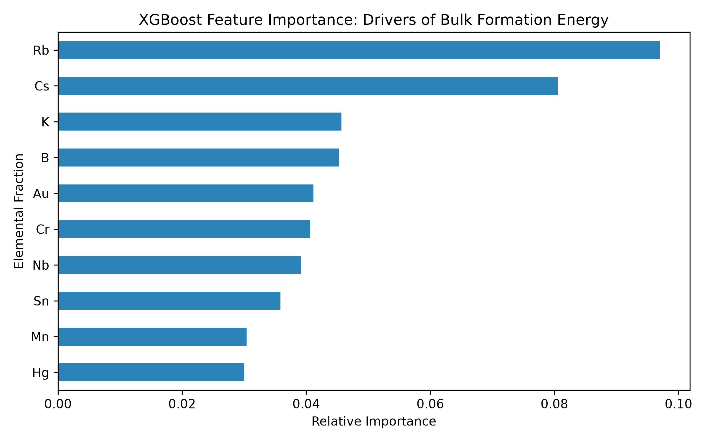

# Machine Learning for DFT-Derived Bulk Formation Energy in Perovskites

## 📌 Scientific Objective
This project implements a machine learning pipeline to predict the **bulk formation energy** ($E_{form}$) of halide and oxide perovskites. By mapping chemical compositions to thermodynamic stability, this repository serves as a baseline materials screening tool.

*(Note: This project previously targeted point-defect screening but has been pivoted to bulk perovskite formation energies to align with the selected dataset).*

## 📂 Dataset Provenance
- **Source:** `matbench_perovskites` (via Matminer)
- **Size:** 18,928 authentic Density Functional Theory (DFT) calculations.
- **Target Variable:** `e_form` (Formation energy in eV/atom).

## ⚙️ Methodology & Limitations
Due to local hardware memory constraints (`MemoryError` during complex structural featurization), this pipeline utilizes **composition-based descriptors** rather than full structural representations. 
- 3D `pymatgen` structures were reduced to chemical formulas.
- Formulas were tokenized via a custom NLP regex parser to extract elemental fractions.
- Models were trained to map elemental stoichiometry directly to quantum mechanical formation energies.

## 📊 Validation & Performance
The models were evaluated on a 20% held-out test set using explicit column mapping (`formula`, `e_form`). 

- **Best Performing Model:** XGBoost
- **R² Score:** 0.313
- **RMSE:** 0.621 eV/atom
- **MAE:** 0.462 eV/atom

## 🔬 Feature Importance

Analysis indicates that the presence of A-site alkali metals—specifically **Rubidium (Rb), Cesium (Cs), and Potassium (K)**—heavily drives bulk thermodynamic stability. This aligns perfectly with known perovskite physics, as the ionic radii of these specific elements directly control the Goldschmidt tolerance factor and dictate phase stability.

## 🚀 Reproducibility
1. Install dependencies: `pip install -r requirements.txt`
2. Fetch the data: `python fetch_dft_data.py` (Generates `perovskite_bulk_energy.csv`)
3. Train models: `python train_model.py`
4. Generate plot: `python plot_features.py`